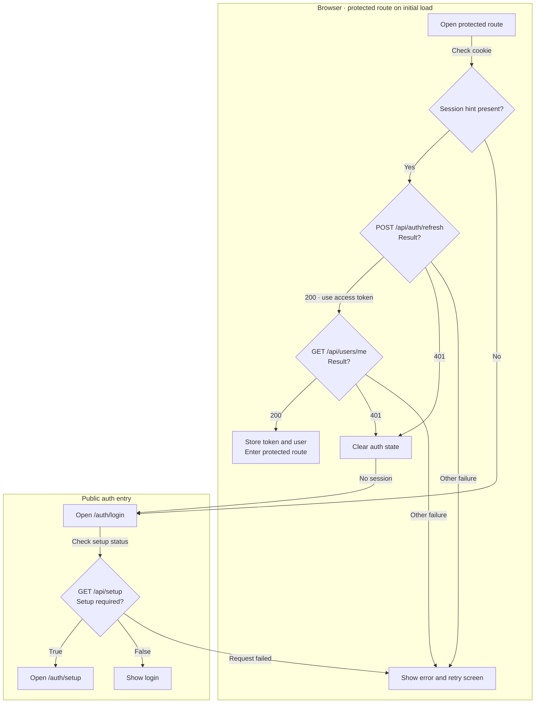

# Authentication and Setup Flow — current implementation

Source: Spring `AuthController`, `SetupController`, `AuthService`, `SetupService`, `JjwtAuthFilter`, `JjwtService`; web `AuthProvider`, `ProtectedRoute`, `AuthEntryGuard`, `App.tsx` and service onboarding hooks. This documents implemented behavior; gaps below are not acceptance guarantees.

## Session bootstrap and requests

- Access tokens remain in frontend memory. On initial load, `AuthProvider` attempts `POST /api/auth/refresh` only when the JavaScript-readable `session_hint` cookie is present. Successful refresh is followed by `GET /api/users/me`; only then are token and identity restored.
- No hint skips refresh. `ProtectedRoute` sends an unauthenticated visitor to `/auth/login`. The public entry guard calls `GET /api/setup`: raw JSON `true` selects `/auth/setup`, `false` selects `/auth/login`.
- Bootstrap refresh `401` clears auth state; other bootstrap failures show an error/retry screen. In-session `apiFetch` retries an HTTP `401` once through one shared refresh promise, **without rechecking the hint or proactively checking token expiry**. It updates the token but does not refetch the user profile on that retry.
- JWT signature/expiry is validated and the current user/role is loaded from the database on every authenticated HTTP request. The JWT subject is **email**, not immutable user ID. Email changes invalidate the old subject until refresh; deletion rejects it while that email is absent. Recreating the same email and established stream lifetime need separate security review.

## Cookies and refresh tokens

Setup/login/refresh set both cookies with 30-day lifetime, `Secure` and `SameSite=Strict`:

| Cookie | HttpOnly | Path | Meaning |
| --- | --- | --- | --- |
| `refresh_token` | yes | `/api/auth` | Opaque 32-byte random bearer value |
| `session_hint=1` | no | `/` | Bootstrap hint only; never proof of authentication |

Refresh tokens are **not signed JWTs**. The service hashes the raw value with SHA-256, finds the database row and checks revocation, expiry, superseded state and session revocation. Missing cookies fail before lookup; empty values are hashed/looked up rather than having a dedicated early rejection. Successful refresh marks the old row superseded and inserts a replacement in the same transaction. Reuse revokes all sessions/refresh tokens for that user and returns `401`; the revocations are retained despite the exception.

Refresh/logout clear both cookies on their service-level `401` and logout success. Revoking the current session clears both; revoking another session does not clear the caller's cookies. Logout revokes **all** refresh tokens belonging to the session. Temporary failures do not clear server cookies. However, frontend `signOut` always clears token/user/query cache and `session_hint` in `finally` and navigates to `/auth/login`, even if server logout failed. The remaining HttpOnly cookie is not proof that revocation succeeded.

Current session-settings gap: revoke success only invalidates the sessions query; it does not immediately clear `AuthProvider` state when the current session is revoked.

## Setup eligibility and first admin

`GET /api/setup` queries `countByRole(ADMIN) == 0` on every request. There is no startup cache, setup-completion record or telemetry-dependent gate.

**Implementation mismatch:** transactional `POST /api/setup` checks total `userRepository.count() > 0`, not admin count. A viewer-only database therefore reports setup required but rejects creation with `409`. Creation is not synchronized; do not claim concurrent setup is serialized. Aligning eligibility and adding concurrency protection are follow-up work.

Successful setup creates the submitted human admin and a separate API-key account (`mustbe@api.email`, role `admin`, random bcrypt-hashed password), plus the human session/refresh token. Tokens and cookies belong only to the human; the generated backing-account password is not returned. `SetupDto` does **not** reserve that email: submitting it for the human causes an insert conflict, not a dedicated validation `400`.

The frontend fetches `/users/me` after setup and opens **`/service-onboarding`**, not `/onboarding`. The API key itself is file-backed (`ApiKeyFile.loadOrCreate`), retained across restarts when its credential volume survives; it is not regenerated at every boot. No real credentials belong in this document.

## Service onboarding after account creation

The admin-only `/service-onboarding` and dashboard `/add-service` share an instrumentation/TLS wizard:

1. Choose new/existing instrumentation, language and SDK/agent instructions, then enter a service name.
2. Choose the HTTPS address (default `https://localhost`). Custom verification calls `POST /api/config/tls/addresses`. `200` and verified `409` are usable results; `202` remains pending with retry guidance. The **Use localhost** shortcut sets local mode client-side without a server verification call.
3. Fetch `/api/config/keys`; embed **only** `ingestion_key` in generated OTLP configuration using `<address>/otlp` and `Authorization=Bearer%20<ingestion_key>` in the header environment variable. The protocol variable is `http/protobuf` except in the recommended Go setup, which uses the guide's HTTP exporter. Local TLS also downloads the public CA from `/api/config/tls/ca` and configures exporter trust.
4. Launch the service, then at verification step 11 open all three live streams with `?service=<encodedName>&token=<encodedJWT>`. `name` is **not** a supported backend alias. Any `onmessage` marks that signal received; any one signal reveals success. Streams remain open for the other signals.
5. Current success links are bare `/logs`, `/traces`, `/metrics` and do not preserve service filtering. Add another service navigates to `/add-service` from first onboarding or resets that wizard locally. Keys remain in the query cache. Reload reconstructs wizard state from step 1 after session restoration.

### Known onboarding gaps

- Keys gate wizard progression, so monitoring is not independent of key loading. There is no persisted service-registration/completion state.
- Verification does not validate message payloads, trim/exact-check returned service names, suppress stale callbacks, close on first success or coordinate backoff/token-expiry refresh. It uses native reconnect plus manual restart of all streams. Dashboard live hooks instead close on error.
- No timer proactively rotates live JWTs; streams reopen when the provider token changes. Server-side live subscriptions do not reauthenticate every pushed record or evict deleted users.
- Generated shell snippets interpolate user input; robust shell escaping remains a follow-up, not an implemented guarantee.
- Standalone Spring's unset ingestion key is generated **in memory** and is not published to the Collector. **Current Compose already supplies a file-backed deployment path:** Vault init seeds matching API/Collector `VIGIL_INGESTION_KEY` secret values, the API imports `configtree:/run/secrets/`, and the Collector starts with `/run/secrets/collector-config.yaml` whose bearer authenticator reads `/run/secrets/VIGIL_INGESTION_KEY`. The environment-based `services/telemetry-collector/runtime/config.yaml` is not Compose's selected configuration. Separate Vault documents can diverge after independent updates; this is not coordinated hot rotation.

## Errors and limits

Custom Spring handlers use `{ message: '<text>' }`, but text is not universally `unauthorized` or `admin role required`: examples are `Invalid username or password`, `invalid Refresh Token`, `invalid request` and `access denied`. There is no catch-all normalizing every framework error. Callback runtime `500` and WS handshake rejection explicitly have empty bodies; post-opening LLM errors are SSE events.

`JjwtAuthFilter` runs **before** `RateLimiter`:

- JWT requests: 60/min per database user + method + exact URI; anonymous requests: 60/min per IP + method + URI.
- Login: 10/min per IP + method + URI. API-key requests: one shared 10/min IP bucket across routes/methods.
- SSE/WS opening GETs count; pushes do not. WS additionally limits every incoming text frame with a separate 10/min per-connection bucket.
- Spring rate error text is `rate limited. Try again in <seconds> seconds.`; the seconds value is floored and can be zero, with no `Retry-After` header. FastAPI ask separately defaults to 5/min per forwarded user ID.

## Additional audited contracts and security boundaries

- JSON naming is snake_case and unknown body fields are rejected (`application.properties`). Body/bean failures return `400 { message: 'invalid request' }`, not the DTO annotation's individual text. Malformed UUID path values return `400 { message: 'Invalid value for parameter: id' }`. Exact-email prechecks return `409 email already registered`; racing integrity conflicts instead return `409 resource already exists`. The precheck is not a lock.
- Login only requires nonblank password, not the setup/create strength regex. Setup/create require a nonblank email and strong password; PATCH email has `@Email` without `@NotBlank`. PATCH null fields are ignored and `{}` is accepted. PATCH password still uses the strength regex; empty is not a no-op. There is no email lowercasing/trimming or reserved-account protection in UsersService. Unknown `role` on PATCH `/users/me` is rejected.
- Password/email edits do not require the old password, revoke sessions or reissue access tokens, including admin edits. Current database roles govern new HTTP requests, but the frontend's cached user is not refreshed by the apiFetch 401 retry. Logout, session revocation and reuse detection revoke refresh credentials, **not outstanding access JWTs**.
- Session list/revoke identify their owner only from the refresh cookie; a supplied JWT/API key is neither sufficient nor compared with that owner. A differing valid header identity can determine rate accounting while cookie identity determines session access. List/revoke service `401` does not clear cookies. Reuse detection also runs on list GET and can revoke all sessions as a side effect. Listing is unordered/unpaginated, includes non-revoked sessions even if their tokens expired, and may return a null user_agent. last_used_at is not updated on every API read.
- Query JWT authentication is accepted by JjwtAuthFilter on **any route/method**, not just SSE. Authorization takes precedence whenever present; `Bearer ` and `ApiKey ` prefixes are case-sensitive. Invalid credentials fail before the rate limiter, including on permitAll paths. Such failures do not consume its budget or run controller cookie cleanup.
- SecurityConfig disables CSRF, uses STATELESS servlet sessions and defines no HTTP CORS policy. SameSite=Strict is not a CSRF token. Auth/setup/WS permitAll path matchers are not method-specific, although controllers still constrain supported methods. The default Spring logout config remains enabled separately from the custom `/api/auth/logout`; no refresh-token invalidation contract should be inferred for framework logout.
- MyHandShake still requires `?token=<JWT>` even if the HTTP auth filter accepted a header. Browser WS origins are restricted to `vigil.front-end-url`. A handshake-generated 401 is empty; an earlier filter-generated 401 has the custom JSON envelope. Existing streams do not gain continuous authorization from those opening checks.
- Rate buckets are process-local, interval-refilled and retained in an unbounded ConcurrentHashMap; no eviction/distributed budget is implemented. Restarts reset them and instances enforce independent budgets. The limiter reads getRemoteAddr; Compose enables native forwarded-header processing, so trusted-proxy configuration can rewrite that address. Do not expose either API connector to untrusted direct clients.
- TLS configure results, successful CA downloads and controller-local unavailable errors set `Cache-Control: no-store`; global validation/auth/rate errors do not receive that header from TlsConfigController. Request DTO validation checks nonblank/max-512 address, while the helper owns allowed-origin validation; Spring validates the helper's returned HTTPS URLs. CA export verifies parsable CA-only X.509 PEM and size, not validity dates, chain trust or a match with the served certificate.
- Startup does not create the API backing user automatically: setup creates it, and the local recovery CLI can restore it. `FtTranscendenceApplication` dispatches `admin reset-password <email>`, `admin delete-all-accounts` and `admin restore-api-user` before starting Spring. These are not HTTP routes. Reset/delete use API-key HTTP calls; recovery can use PostgreSQL with confirmation. Delete-all preserves the API admin, commits individual deletes separately and therefore does not reopen setup.

## Evidence map

Paths below are relative to `Desktop/vigil/`; these are static source findings, not claims that deployment/integration tests passed.

| Contract | Primary sources |
| --- | --- |
| Setup eligibility, account creation, login/refresh/session lifecycle | `services/api/src/main/java/com/ft_transcendence/vigil/controllers/{SetupController,AuthController}.java`; `services/api/src/main/java/com/ft_transcendence/vigil/services/{SetupService,AuthService}.java` |
| User roles, mutations and validation | `services/api/src/main/java/com/ft_transcendence/vigil/controllers/UsersController.java`; `services/api/src/main/java/com/ft_transcendence/vigil/services/UsersService.java`; `services/api/src/main/java/com/ft_transcendence/vigil/domain/dtos/{auth,users}/`; `services/api/src/main/java/com/ft_transcendence/vigil/domain/entities/UsersAuth/` |
| Filter order, headers/query JWT, role resolution, errors | `services/api/src/main/java/com/ft_transcendence/vigil/configuration/SecurityConfig.java`; `services/api/src/main/java/com/ft_transcendence/vigil/security/{JjwtAuthFilter,JjwtService}.java`; `services/api/src/main/java/com/ft_transcendence/vigil/exceptions/GlobalExceptionsHandler.java`; `services/api/src/main/resources/application.properties` |
| Credentials, startup and local recovery | `services/api/src/main/java/com/ft_transcendence/vigil/configuration/{VigilProperties,Configurations,InternalPortConfig}.java`; `services/api/src/main/java/com/ft_transcendence/vigil/security/ApiKeyFile.java`; `services/api/src/main/java/com/ft_transcendence/vigil/FtTranscendenceApplication.java`; `services/api/src/main/java/com/ft_transcendence/vigil/cli/{ApiAdminCli,ApiAccountRecovery}.java` |
| Limits and WebSocket boundary | `services/api/src/main/java/com/ft_transcendence/vigil/ratelimiter/{RateLimiter,RateLimiterRegistry,ApiRateLimitPolicy}.java`; `services/api/src/main/java/com/ft_transcendence/vigil/websocket/{MyHandShake,WebSocketConfiguration}.java` |
| TLS response validation and CA | `services/api/src/main/java/com/ft_transcendence/vigil/controllers/{ConfigController,TlsConfigController}.java`; `services/api/src/main/java/com/ft_transcendence/vigil/services/TlsConfigService.java` |
| Actual Compose ingestion-secret path | `docker-compose.yml`; `security/vault/scripts/init-vault.sh`; `security/vault/agent/{api.hcl,collector.hcl,collector-config.tpl}` |
| Browser auth and wizard | `services/web/src/auth/{AuthProvider,AuthEntryGuard,ProtectedRoute}.tsx`; `services/web/src/api/{authApi,serviceOnboardingApi}.ts`; `services/web/src/hooks/useServiceOnboarding.ts` |

## Needed implementation tests (not added in this audit)

1. HTTP contract matrix: anonymous/admin/viewer/API-key; exact response status/body/cookies for every setup/auth/users/config route, unknown fields, invalid enums, malformed UUIDs, blank/null values and duplicate-email precheck versus integrity-race failures.
2. Setup states: empty, viewer-only, API-admin-only and reserved-email databases; concurrent setup and concurrent last-admin delete/demotion. Assert current behavior separately from desired serialization/eligibility fixes.
3. Refresh/session lifecycle: rotation, superseded reuse through all four service methods, committed all-session revocation on 401, concurrent same-token refresh, sliding lifetime, cookie cleanup only at documented controller paths, mismatched JWT/cookie owners, foreign/missing session targets and expired-token session listings.
4. Access-token lifecycle: logout/password change/session revoke retain outstanding JWT validity; email change/recreation and user deletion/demotion affect HTTP authentication as documented. Separately exercise already-open SSE/WS and current-session revoke UI cleanup.
5. Filter/rate boundaries: invalid credentials before limiter, query JWT on non-live routes, header precedence/case, login and shared API-key buckets, exact-URI/query separation, refill/zero-second errors, independent instances and trusted-forwarded-address handling.
6. TLS/cache matrix: 200/202/verified-409/400/503, malformed/oversized/timed-out helper frames, global validation/auth/rate responses, CA-only certificate parsing, stale/expired CA acceptance and unavailable files. Assert that no private material escapes.
7. Deployment: retained/lost/invalid API credential volume, unset/stable JWT secret across restart, Vault initial import/backfill and rendered API/Collector ingestion-key agreement. Verify live authenticated OTLP ingestion using the Compose-selected config and model secret divergence/restart behavior.
8. Browser flows: hint/no-hint, refresh or `/users/me` 401 versus temporary failures, shared refresh within one provider versus multiple tabs, cached role after demotion, failed logout, current-session revoke, TLS pending/manual retry and localhost shortcut, wizard reload and stale/expired live-stream callbacks.
